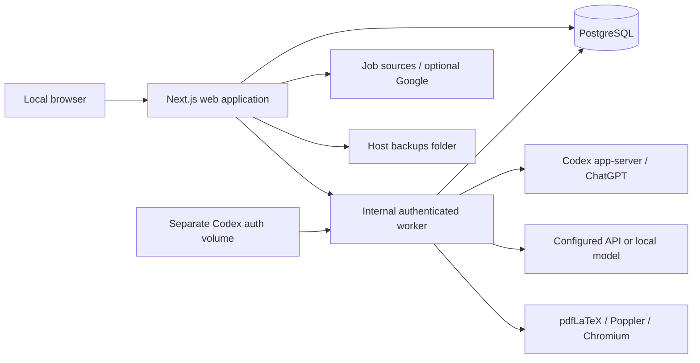

# Architecture

AI Resume Workflow is a local single-user Next.js/React/TypeScript application backed by Prisma and PostgreSQL. It preserves Dossier's visual profile, document and application workflows while adding V5 orchestration. The web service is the sole host-published entry point; the worker and database communicate on the private Compose network.

## Records and workflow boundaries

Profile, work history, project evidence and architecture explanations form a complete versioned KB. Snapshots preserve the past; uploaded reference PDFs do not silently become approved facts. A posting occurrence preserves the full JD, source/date evidence and extracted fields. Repeated sightings reuse occurrences; supported repost dates allow a new occurrence.

Discovery runs independently and records coverage findings. Only explicit user selection enters the tailoring queue. PostgreSQL claims, leases and stage checkpoints protect durable execution. A unique running-preparation constraint permits one active tailoring application, including revisions. The start of a preparation freezes its KB, JD and options. Restart recovery resumes valid checkpoints; a worker that loses its lease cannot overwrite the new owner.

The planner examines every project and freezes five candidate IDs before resolving the template. The editor applies track composition and evidence boundaries; the reviewer checks the resulting document. pdfLaTeX is the default renderer, with Chromium for explicit HTML theme overrides. Shell escape is disabled. Poppler extracts and rasterizes the actual PDF for checks and preview. A passing preparation enters Pending submission; a submission record freezes the selected verified revisions and score. Later edits create another generation rather than rewriting history.

## Execution and privacy

Codex uses its ChatGPT-authenticated app-server in the worker. Hosted/local provider tasks use application orchestration. Full context is required; context or capability failures are surfaced rather than silently dropping evidence. Authentication/quota failures do not switch billing routes. Authentication lives outside ordinary backups, in a separate volume.

Local hosting does not imply offline processing: selected hosted models, job sources and optional Google integrations communicate externally. Provider choice determines where relevant input is processed. No external assistant connector, cloud deployment, automatic application submission or scheduled outbound mail is part of V1. Upstream telemetry and update prompts are disabled.

## Recovery and limits

M7 adds checksummed versioned archives covering application records and document content, with host-visible storage. Secrets and Codex authentication are excluded; restored installations require reconnection. See [release and recovery](RELEASE.md) for the release gate and operating procedure.

The worker image includes development dependencies to execute TypeScript and generate its Prisma client. This favors reproducibility over image size. Mermaid source is stored but not automatically rendered; uploaded images provide architecture previews. Verification supports human review but cannot prove every model interpretation or remote link's availability.
