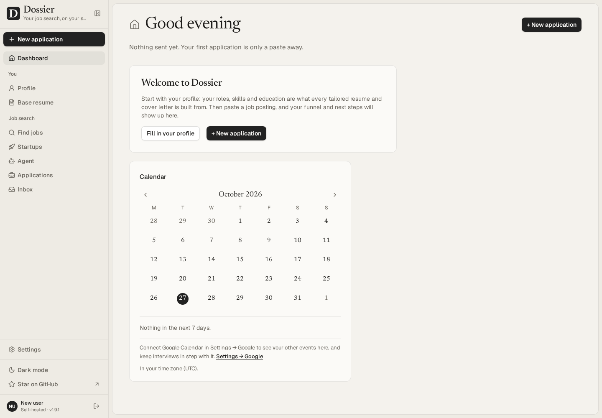
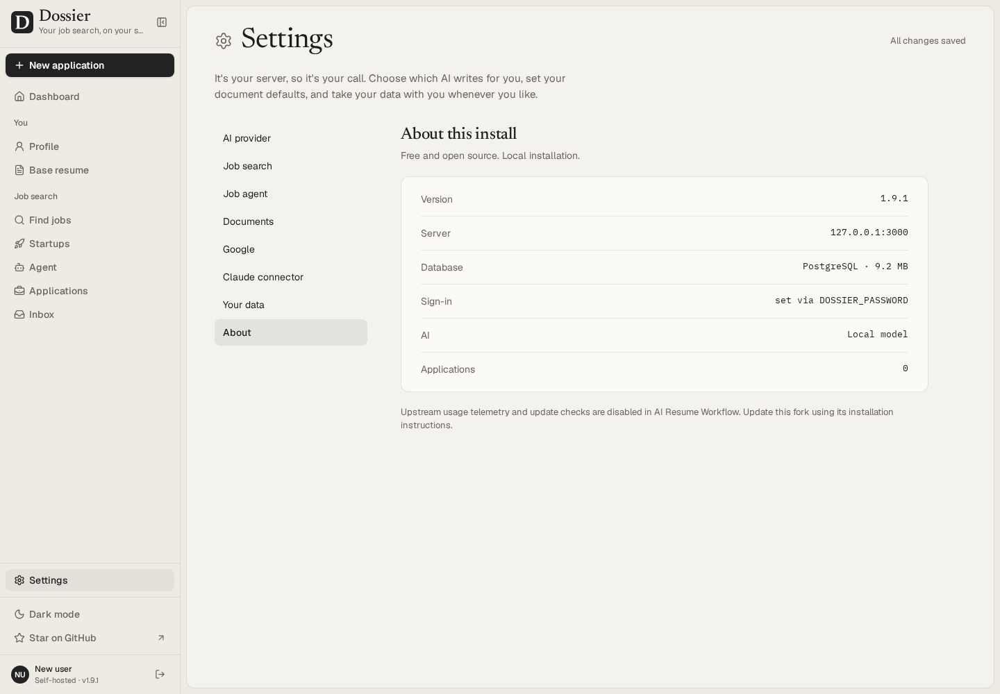

# M0 review — local fork baseline

Review date: October 27, 2026. Status: ready for user review; no remote fork or push authorized yet.

## Delivered

- Full Dossier history retained at baseline `3271c8b2900082e0caa1ed42765b71d28134c0c1`; local branch `milestone/m0`, `upstream` remote only.
- Local Docker development app starts, migrates and seeds its empty database. Web binds to `127.0.0.1:3000`; database has no host port. Managed `pgdata` and `appdata` volumes preserve records and files.
- Local configuration generator creates a password hash and random database/session secrets, refuses overwrite, and does not print secrets. Private/runtime/auth/backup folders are excluded from Git and image context.
- Upstream telemetry and release requests are removed. Legacy opt-in settings cannot re-enable them; cached update notices and opt-in controls are hidden. Next.js telemetry is disabled in Docker.
- Approved V1 scope, milestones, agent ownership, setup and attribution documented. AGPL license/history retained; upstream README archived. No personal V5 content imported or changed.
- CI retains checks and image builds but cannot publish images; automatic releases remain disabled until the release milestone.

## Verification

| Check | Result |
| --- | --- |
| Pinned upstream lint / type check / production Next build | Passed |
| Pinned upstream Vitest + real PostgreSQL + coverage | 1,680 passed; 26 opt-in live tests skipped; 206 files passed |
| Pinned upstream Playwright | 137 passed |
| Fork privacy lint / type check / production Next build | Passed in isolated worktree with the same integrated source |
| Fork Vitest + real PostgreSQL + coverage | 1,647 passed; same 26 live tests skipped; 206 files passed |
| Integrated production Next build | Passed |
| Integrated privacy / data / accessibility browser suite | 80 passed |
| Docker development image build and Compose startup | Passed |
| App-data write and read after app restart | Passed |
| Setup syntax, generated password verification, overwrite refusal, Compose configuration assertions | Passed by infrastructure agent |
| Independent privacy/infrastructure review | Passed; Linux ownership and production-test issues corrected |
| Diff whitespace check | Passed |

Fork coverage: statements 86.35%, branches 79.95%, functions 84.67%, lines 88.40%. Original global and per-module thresholds remain unchanged and pass. The smaller test count reflects replacement of tests for removed upstream telemetry/update behavior with fork-specific regressions.

Live provider/search checks are intentionally opt-in and were not run. Browser tests use fictional records and fake AI/search/Google services; they send no real emails or applications. Upstream browser logs contain non-failing `destination stream closed early` messages during navigation; database tests contain upstream pg deprecation warnings. No test failures were suppressed.

Local detailed logs are in ignored `runtime/m0/`. No credentials or personal data belong in the review artifacts.

## Visual review

## Try it locally

Follow [README setup](../README.md#local-setup) for a fresh installation. For this already configured development checkout, `docker compose up -d` starts the app at <http://localhost:3000>. Use the temporary review password supplied in the milestone handoff; replace that local configuration before entering personal data. The password is not stored in repository documentation.

`docker compose stop` stops it without deleting volumes. Do not use `down --volumes` for data you want to keep.

Review the changes with `git diff 3271c8b2900082e0caa1ed42765b71d28134c0c1` and the local milestone commits. Worker changes were integrated from isolated privacy, infrastructure and documentation worktrees; the coordinator reviewed docs and integrated runtime behavior.

## Limits and next gate

- This is the upstream application baseline, not finished V1. Dossier branding and inherited features remain. Codex subscription execution, V5 KB/templates/queue, and connector removal belong to subsequent milestones.
- Development Docker is exercised on Docker Desktop's Linux engine on Windows. The production Compose configuration is validated, and the production Next build passes; the full production Docker image and native Linux/macOS startup have not been exercised.
- No live AI, job-board, Gmail or Calendar accounts are connected. Personal migration remains deferred.
- No GitHub fork has been created and nothing has been pushed.

Implementation is paused for the user's M0 review. Approval authorizes creating `ai-resume-workflow` under the authenticated GitHub account, configuring `origin`, pushing this baseline, and starting M1. It does not authorize deployments or application submissions.
