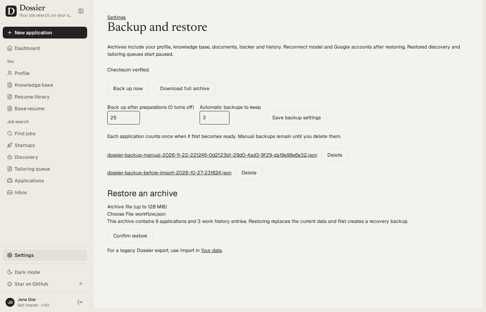
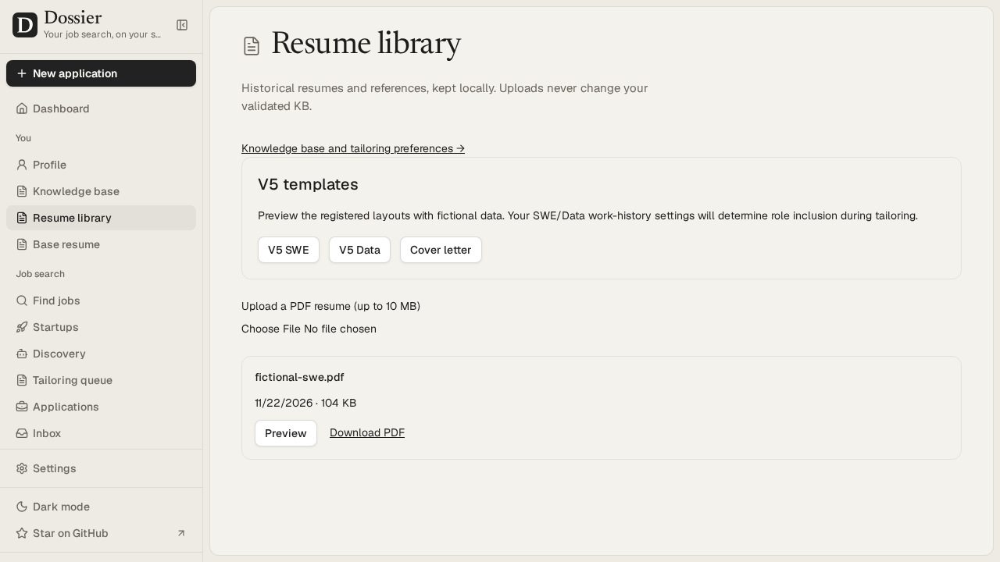

# M7 review — backup recovery and V1 packaging

Status: approved by the user November 23, 2026, including the M7 push and `workflow-v1.0.0` release tag. Reviewed implementation commit: `2c692b9`.

## Delivered

- Settings → Backup and restore: manual archive, download, configurable preparation count and automatic retention, checksum preview and explicit restore confirmation.
- Defaults: every ten first-ready preparations; retain ten automatic archives. Revisions/retries do not increment the preparation count again. Manual archives remain until deleted.
- Host-visible `backups/` mount. Ten existing local backups were copied and preserved before switching mounts.
- Version-1 full archives preserve profile/work/project records, KB snapshots and architecture assets, reference PDFs, prepared PDF/source/report/evidence, submissions and tracker history, themes and non-secret settings. The installed V5 formatting source is included and checked for compatibility.
- Credentials, Google tokens and Codex authentication are excluded. Runtime execution jobs are not replayed. Restored tailoring stays paused and discovery scheduling stays disabled.
- Atomic database restore with schema/checksum checks, before-import recovery copy, protected built-in themes, submission-trigger-safe counter restore and transactional sequence restart. Legacy Dossier imports remain supported and clear replaced V5 state/counters.
- Setup, connections, architecture, recovery, upgrades, troubleshooting and upstream contribution documentation. Fictional demo remains in `prisma/seed/demo.ts`; personal migration is deferred.

## Verification

Lint, TypeScript and production build passed. The complete unit/database suite passed **1,897 tests**, with **29 environment-dependent tests skipped**. Coverage: statements 85.18%, branches 79.56%, functions 83.38%, lines 87.84%. The final complete Chromium suite passed **156 tests**, including light/dark accessibility, preparation, review, tracking, legacy import and backup/restore. Fresh Docker source/target installations passed migration, health, login, backup defaults, manual archive and export checks. A fresh target restored nine fictional applications and twelve compared tables, including KB, architecture image/text, resume library, prepared revision, submission links and email findings. PDF bytes matched SHA-256 `77f7d523d0c0984fd82631739595bd1273057f479dc46a30574190cbfa6986bf`. The test secret was excluded and the restored queue was paused. The final image also restored successfully over the populated target with the same twelve-table and PDF comparisons. Both isolated verification installations were stopped afterward; their volumes were retained.

Independent review identified legacy backup-baseline serialization and sequence rollback issues; both were corrected. An interrupted-restore regression also exposed submission-deletion triggers repopulating the backup ledger; restore now clears that ledger after those triggers and before insertion.

The initial full browser run had a publication test that navigated before its debounced link save finished, then a dependent test failed. The test now waits for the persisted link; all three publication flows passed on recheck. Assertions were retained.

Local evidence logs (ignored by Git): `runtime/m7-acceptance-final.log`, `runtime/m7-e2e-final.log`, `runtime/m7/populated-restore-result.log`; fresh-volume evidence is in the release worktree `runtime/m7-restore-result.log`. Database tests cover checksum corruption, invalid-reference rollback, sequence rollback before commit, exact-once preparation counting, retention and failed-backup retries.

## Review locally

Open [Backup and restore](http://localhost:3000/settings/backups). Manual backups and settings are safe to review on your installation. Restore replaces data; use a separate fictional installation when trying the restore flow.

## Limits

- Browser archive upload limit: 128 MiB, including the request envelope. Archives are unencrypted personal data; credentials are excluded. Keep copies outside the original disk for disk-failure recovery.
- Restore requires a compatible schema and matching template master. Stop/cancel active work first; reconnect accounts and deliberately resume schedules/queues afterward.
- Live model and Google integrations were not rerun for M7. Prior milestone reports distinguish live Codex evidence from fake provider/mail tests. Provider output still requires review.
- Mermaid is editable source; architecture previews use uploaded images. Docker bundles LaTeX; no host compiler is required.
- Dossier branding and its attribution remain visible. The repository documents original fork contributions separately from inherited work.

The user approved the M7 push and V1 tag on November 23, 2026. The release uses `workflow-v1.0.0` to avoid overwriting inherited upstream tags.